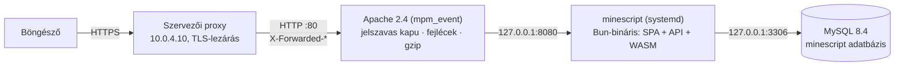

# Éles telepítés: verseny szerver

Az éles cím: `https://minescript.hu` (Cloudflare mögött, jelszavas kapu nélkül). Az alkalmazás a szervezők által adott Ubuntu 22.04-es gépen fut (2 vCPU, 3,8 GiB RAM). A gép saját címe `csapat13.dusza.cloudsyso.com`: ezen megy az SSH, és ezen a címen véd a jelszavas kapu. A szerveren maga a forrás fordul (Rust → WASM → Vite → egyetlen Bun-bináris), így a frissítés egyetlen parancs: `just deploy`.

## Röviden

| Mit akarsz                                      | Parancs (a saját gépedről)         | Parancs (a szerveren)                |
| ----------------------------------------------- | ---------------------------------- | ------------------------------------ |
| a main legfrissebb állapotát élesíteni          | `just deploy`                      | `minescriptctl deploy`               |
| egy ágat vagy commitot élesíteni                | `just deploy --ref futozs`         | `minescriptctl deploy --ref <ág>`    |
| ugyanazt a commitot újraépíteni                 | `just deploy --force`              | `minescriptctl deploy --force`       |
| visszaállni az előző kiadásra                   | `just remote rollback`             | `minescriptctl rollback`             |
| állapot (verzió, health, kapu, kiadások)        | `just remote status`               | `minescriptctl status`               |
| naplók                                          | `just remote logs`                 | `minescriptctl logs -f`              |
| a jelszavas kapu ki- és bekapcsolása            | `just remote gate off` / `gate on` | `minescriptctl gate off` / `gate on` |
| új kapu-jelszó                                  | `just remote gate passwd csapat13` | `minescriptctl gate passwd csapat13` |
| automatikus telepítés a main-ről (2 percenként) | `just remote autodeploy on`        | `minescriptctl autodeploy on`        |
| adatbázis-mentés                                | `just remote backup`               | `minescriptctl backup`               |

A `just deploy` és a `just remote` SSH-n át a szerveren futtatja a `minescriptctl`-t. Belépés: `ssh -p 2200 csapat13@csapat13.dusza.cloudsyso.com`. Az SSH a szervezők sshpiper-átjáróján megy, ami csak jelszót fogad el, kulcsot nem. A jelszó a szervezőktől jött, és nem kerül a repóba. Ha be van állítva a `SSHPASS` környezeti változó, és telepítve van az `sshpass`, akkor a parancs nem kéri be a jelszót.

## Felépítés



- **TLS**: a szervezői proxy zárja le, és a gép 80-as portjára továbbít. Megtartja a `Host` fejlécet, és `X-Forwarded-Proto: https`-t küld. A `mod_remoteip` (szervezői beállítás, `dusza-remoteip.conf`) a valódi kliens IP-címét állítja vissza.
- **Apache**: csak fordított proxy. Fájlt nem szolgál ki, kivéve a karbantartási oldalt. A kaput (HTTP Basic Auth) az Apache kéri, mielőtt bármi elérné az alkalmazást.
- **Alkalmazás**: a `just release`-zel azonos bináris (`bun build --compile`), benne a SPA, a `.wasm` és a migrációk. Csak a `127.0.0.1:8080`-on figyel, a `minescript` rendszerfelhasználóval fut.
- **MySQL**: a gépen futó MySQL 8.4 (nem Docker). Csak a `127.0.0.1`-en figyel.

## Fájlok a szerveren

| Útvonal                                                     | Tartalom                                                                                                |
| ----------------------------------------------------------- | ------------------------------------------------------------------------------------------------------- |
| `/srv/minescript/repo`                                      | a GitHub-repó klónja; itt fordul a kód (a `target/`, `node_modules/` cache megmarad)                    |
| `/srv/minescript/releases/<idő>-<commit>/`                  | kiadások: `minescript` bináris és `REVISION` (commit, ág, idő); az utolsó 5 marad meg                   |
| `/srv/minescript/current`                                   | szimbolikus link az élő kiadásra (atomi csere)                                                          |
| `/srv/minescript/backups/`                                  | tömörített `mysqldump`-ok (minden telepítés előtt; az utolsó 20 marad meg; 700-as jog)                  |
| `/srv/minescript/www/karbantartas.html`                     | ezt mutatja az Apache, amíg az alkalmazás újraindul (502/503/504)                                       |
| `/usr/local/bin/minescriptctl`                              | a vezérlő (a `scripts/deploy/minescriptctl` másolata; frissítés: `minescriptctl self-update`)           |
| `/etc/minescript/minescript.env`                            | `DATABASE_URL`, `HOST`, `PORT`, `TRUST_PROXY`, `MINESCRIPT_GITHUB_TOKEN`; `root:minescript`, 640-es jog |
| `/etc/systemd/system/minescript.service`                    | az alkalmazás szolgáltatása                                                                             |
| `/etc/systemd/system/minescript-autodeploy.{service,timer}` | automatikus telepítés (alapból ki van kapcsolva)                                                        |
| `/etc/apache2/sites-available/minescript.conf`              | a virtuális hoszt                                                                                       |
| `/etc/apache2/conf-available/zz-minescript-hardening.conf`  | globális Apache-szigorítás                                                                              |
| `/etc/apache2/minescript/gate.conf`, `htpasswd`             | a kapu; ha a `gate.conf` hiányzik, az oldal nyilvános                                                   |
| `/etc/mysql/mysql.conf.d/zz-minescript.cnf`                 | a MySQL csak a localhoston figyel                                                                       |
| `~csapat13/.ssh/minescript_deploy`                          | csak olvasó GitHub deploy key (a `buninstall/dusza-2026` repó „Deploy keys” listájában)                 |

A forrásban mindez a `scripts/deploy/` alatt van: `minescriptctl` (vezérlő), `provision.sh` (egyszeri telepítés) és `templates/` (systemd, Apache, MySQL, karbantartási oldal).

## Mi történik egy `deploy` alatt

1. **Zár**: `flock`, így egyszerre csak egy telepítés futhat (kézi és automatikus sem fut egymásra).
2. **Frissítés**: `git fetch origin`, majd a helyi `main` ág az `origin/main`-re áll (`checkout -B`), és a `git clean` eltávolítja a nem követett fájlokat. A build-cache-ek (`target/`, `node_modules/`, `packages/engine/pkg/`) ignoráltak, ezért megmaradnak. Ez a `git pull` megbízható megfelelője: helyi módosítás nem akaszthatja meg.
3. **Kihagyás**: ha ez a commit már élesben van, nincs teendő (`--force` újraépít). Ha ugyanez a commit egyszer már elbukott, nem próbálja újra kétpercenként (`--force` igen).
4. **Eszközök igazítása**: a Rust a `rust-toolchain.toml` szerint települ, a Bun a `package.json` `packageManager` mezője szerint, a wasm-bindgen-cli a `Cargo.lock` verziója szerint (előre fordított bináris).
5. **Build**, `nice` alatt, hogy az élő oldal ne lassuljon: `bun install --frozen-lockfile`, `just build` (WASM + wasm-opt, Vite, statikus manifeszt, migrációk), végül `bun scripts/release.ts bun-linux-x64`.
6. **Új kiadás**: a bináris a `releases/<idő>-<commit>/` alá kerül, mellé a `REVISION` fájl.
7. **Mentés**: `mysqldump` a `backups/` mappába, mert az új bináris induláskor migrálhat.
8. **Atomi csere**: a `current` link átáll az új kiadásra, jön a `systemctl restart`, majd legfeljebb 30 másodpercig a health check (`/api/health`).
9. **Automatikus visszaállás**: ha az új verzió nem lesz egészséges, kiírja a napló végét, visszaállítja a `current` linket az előző kiadásra, újraindít, és hibával lép ki.
10. **Takarítás**: az utolsó 5 kiadás marad meg, az élő és az előző soha nem törlődik.

Ha a build elbukik, az élő verzió változatlan marad. Egy frissítés változatlan függőségek mellett kb. 15 másodperc, hideg cache-sel kb. 70 másodperc. Az újraindulás alatt (kb. 1 másodperc) az Apache a karbantartási oldalt mutatja, ami 5 másodpercenként újratöltődik.

A visszaállás csak a binárist cseréli, az adatbázis-sémát nem. Ha egy migráció is hibás volt, a telepítés előtti mentésből lehet visszatölteni (lásd lent).

### Automatikus telepítés

`minescriptctl autodeploy on`: a `minescript-autodeploy.timer` kétpercenként lefuttatja a `minescriptctl deploy`-t. Ha a main nem változott, ez egy `git fetch`, és semmi más. A csapat munkafolyamatában a saját ágak 25 percenként kerülnek a main-re, így a szerver magától követi a main-t. Napló: `minescriptctl logs --deploy`. Kikapcsolás: `minescriptctl autodeploy off`.

## A jelszavas kapu

A kapu az Apache virtuális hosztra vonatkozik, nem egy címre: ha be van kapcsolva, az a hoszt minden címén kér jelszót, így a `https://minescript.hu` is, ha a forgalma erre a hosztra jut. Élesítés előtt ezt a címen ellenőrizni kell. Amíg a kapu be van kapcsolva, a böngésző azon a címen minden kérésnél (az oldalnál, az API-nál és a fájloknál is) felhasználónevet és jelszót kér. Ezt az Apache ellenőrzi (HTTP Basic Auth, bcrypt cost 12). Hibás belépés után az alkalmazásig semmi sem jut el, a 401-es válasz pedig nem árul el semmit a mögötte lévő rendszerről. Az `Authorization` fejlécet az Apache a hitelesítés után eltávolítja, így az alkalmazás nem kapja meg. Az alkalmazás saját belépése (cookie) ettől független, és változatlanul működik.

- Felhasználó: `csapat13`. A jelszót a telepítéskor véletlenszerűen generáltuk, csak egyszer jelent meg, és nincs a repóban. Új jelszó: `minescriptctl gate passwd csapat13`.
- Újabb felhasználó (például a zsűrinek): `minescriptctl gate passwd zsuri`. Törlés: `minescriptctl gate remove zsuri`.
- Nyilvánossá tétel: `minescriptctl gate off`. Visszakapcsolás: `minescriptctl gate on`. Mindkettő `apachectl configtest` után, kiesés nélküli `reload`-dal történik.
- Kivétel csak a `/_minescript/karbantartas.html`: ezt a hibaoldal miatt kapu nélkül is ki kell tudni szolgálni, és nem tartalmaz semmi érzékeny adatot.

A demó-fiókok (`admin / dusza2026`, `demo1–3 / demo2026`) jelszava a forrásban és a felületen is szerepel. Amíg a kapu be van kapcsolva, ez nem gond. Nyilvános üzemben viszont bárki adminként léphet be. A jelszócserének nincs felülete: a demó-fiókok jelszavát adatbázisban kell átállítani, vagy a kapu bekapcsolásával kell zárni az oldalt. A szerver indításkor kiírja a demó-jelszavakat a naplóba, ezért a nyilvános naplót is ennek megfelelően kell kezelni.

## Asztali alkalmazás letöltése és frissítése

A MineScript Desktop kiadásai a privát repó `desktop-v*` kiadásaiban vannak (a `release.yml` minden `main`-re kerülő desktop-változásnál épít, aláír és `latest.json`-t tesz mellé). A belépőoldal és a felhasználói menü letöltése, valamint az alkalmazás beépített frissítője is a szerveren át éri el őket (`/api/desktop/*`, lásd `docs/contracts.md`).

- Token: GitHub fine-grained personal access token, csak a `buninstall/dusza-2026` repóra, `Contents: Read-only` joggal. A `/etc/minescript/minescript.env`-be kerül: `MINESCRIPT_GITHUB_TOKEN=github_pat_…` (más repó esetén `MINESCRIPT_DESKTOP_REPO=owner/repo`), utána `sudo systemctl restart minescript`. Token nélkül a letöltés menü nem jelenik meg.
- A frissítő a csomagok aláírását a beépített nyilvános kulccsal ellenőrzi. A titkos kulcs a GitHub `TAURI_SIGNING_PRIVATE_KEY` titkában van; ha elveszik, a telepített kliensek nem frissíthetők, csak újratelepítéssel.
- Amíg a jelszavas kapu be van kapcsolva, a böngésző a kapun át tölt le; az asztali kliens frissítője a kapu fejlécét (`MINESCRIPT_GATEWAY_TOKEN`) küldi, ugyanúgy, mint az alkalmazás többi kérése.

## Biztonsági beállítások

### Apache

- Csak fordított proxy: `ProxyRequests Off`, `ProxyPreserveHost On` (a CSRF-ellenőrzés a `Host`-ot az `Origin`-hez hasonlítja), a `DocumentRoot` egy üres mappa, sehol nincs `Options` (se könyvtárlista, se symlink követés).
- Kikapcsolt modulok: `php8.3`, `mpm_prefork` (helyette `mpm_event`, ami proxyhoz hatékonyabb), `status`, `autoindex`, `cgi`; kikapcsolt konfiguráció: `serve-cgi-bin`. A szervezői `000-default` oldal sincs bekapcsolva.
- `ServerTokens Prod`, `ServerSignature Off`: a `Server` fejléc csak `Apache`, verzió és operációs rendszer nélkül, a hibaoldalakon pedig nincs aláírás. `TraceEnable Off`, `FileETag None`.
- A pontos útvonalak (`/.git`, `/.env` és társaik) 403-at kapnak, a `.well-known` kivételével. Fájlrendszeri szinten a mentés-, napló- és konfigurációs kiterjesztések is tiltva vannak.
- Méretkorlátok: törzs 2 MiB (az alkalmazásé 1 MiB), fejlécmező 16 KiB, legfeljebb 100 fejléc. A `mod_reqtimeout` véd a lassú (slowloris jellegű) kérések ellen.
- Az alkalmazás felé `X-Forwarded-Proto: https` megy (ettől kap a session cookie `Secure` jelzőt), az `Authorization` és a `Proxy` fejléc pedig nem (httpoxy).
- Biztonsági fejlécek: az alkalmazás saját fejlécei (CSP, HSTS és társaik) érintetlenül mennek tovább. Az Apache csak akkor tesz alapértéket (`nosniff`, `DENY`, `Referrer-Policy`, HSTS, `Permissions-Policy`, COOP), ha a válaszból hiányzik, például a 401-es és 503-as oldalakon. Így semmi sem duplikálódik. Minden válaszon `X-Robots-Tag: noindex, nofollow`.
- Tömörítés (gzip): HTML, JS, CSS, JSON, SVG és `application/wasm`. A hashelt `/assets/*` fájlok egy évig, `immutable`-ként cache-elhetők.
- Saját naplók: `/var/log/apache2/minescript-{access,error}.log` (a rendszer logrotate-je forgatja), a valódi kliens IP-címével.

### Alkalmazás (systemd)

A `minescript` rendszerfelhasználó nem tud belépni, és nincs saját könyvtára. A `systemd-analyze security minescript` pontszáma 1.2 („OK”):

- `ProtectSystem=strict`, `ProtectHome`, `PrivateTmp`, `PrivateDevices`, `PrivateUsers`, `ProtectProc=invisible`. Írni csak a saját `/var/lib/minescript` könyvtárába tud.
- `NoNewPrivileges`, üres `CapabilityBoundingSet`, `SystemCallFilter=@system-service`, `RestrictNamespaces`, `LockPersonality`, `RestrictSUIDSGID`.
- Hálózat: `IPAddressAllow=localhost`, és `IPAddressDeny` a magáncímekre, a link-local és a CGNAT tartományra (`10.0.0.0/8`, `172.16.0.0/12`, `192.168.0.0/16`, `169.254.0.0/16`, `100.64.0.0/10`, `fc00::/7`, `fe80::/10`). Az alkalmazás a helyi MySQL-t és az internetet éri el (a GitHub API-t az asztali kiadásokhoz), a belső hálózatot és a metaadat-címeket nem. A DNS a `127.0.0.53`-on futó `systemd-resolved`-en át megy, ezért a localhost engedélye elég hozzá.
- Erőforrás-korlátok: `MemoryMax=1G`, `TasksMax=512`. Leállás esetén `Restart=always`, 2 másodperc múlva újraindul.
- `TRUST_PROXY=1`: a belépési korlát (5 próbálkozás / perc / IP + név) az `X-Forwarded-For` utolsó elemét tekinti a kliens címének. Ezt a helyi Apache fűzi hozzá, ezért kívülről nem hamisítható. Enélkül minden kérés a `127.0.0.1`-ről jönne.

### MySQL

- Saját adatbázis (`minescript`, `utf8mb4_0900_ai_ci`) és saját fiók (`minescript@127.0.0.1`), jog csak erre az adatbázisra. A jelszó 64 hexa karakter, és csak a `/etc/minescript/minescript.env`-ben van meg.
- A MySQL és az X Protocol (33060) csak a `127.0.0.1`-en figyel, a `local_infile` ki van kapcsolva. A `root` csak a gépen belül, `sudo mysql`-lel érhető el (`auth_socket`).

## Adatbázis

```bash
sudo mysql minescript
minescriptctl backup
ls -lh /srv/minescript/backups
gunzip -c /srv/minescript/backups/minescript-<idő>.sql.gz | sudo mysql
```

A visszatöltés előtt állítsd le az alkalmazást (`sudo systemctl stop minescript`), utána indítsd újra (`sudo systemctl start minescript`). Mivel a mentés `--databases` kapcsolóval készül, a dump maga választja ki a `minescript` adatbázist. A demó-adatokkal való teljes újrakezdéshez (minden felhasználói adat törlődik!) egyszer kézzel kell elindítani a binárist:

```bash
sudo systemctl stop minescript
sudo -u minescript env $(sudo cat /etc/minescript/minescript.env | xargs) /srv/minescript/current/minescript --no-open --reset-demo
```

Ha a „Demó-adatok létrehozva” sor megjelent, állítsd le Ctrl+C-vel, majd indítsd a szolgáltatást: `sudo systemctl start minescript`.

## Naplók és hibaelhárítás

| Tünet                              | Teendő                                                                                              |
| ---------------------------------- | --------------------------------------------------------------------------------------------------- |
| a karbantartási oldal nem tűnik el | `minescriptctl status`, `minescriptctl logs`; ha az új verzió a hibás: `minescriptctl rollback`     |
| a `deploy` „korábban már elbukott” | javítsd a hibát a main-en (új commit), vagy próbáld újra: `minescriptctl deploy --force`            |
| a build elfogy a memóriából        | van 2 GiB swap; `free -h`; a build `nice` alatt fut                                                 |
| Apache-hiba                        | `sudo apachectl configtest`, `minescriptctl logs --apache`, `sudo journalctl -u apache2`            |
| MySQL-hiba                         | `sudo systemctl status mysql`, `sudo journalctl -u mysql`; az alkalmazás magyarul írja ki a teendőt |
| a `git fetch` nem megy             | `ssh -T git@github.com` (a deploy key-nek szerepelnie kell a repó beállításaiban)                   |
| elfogyott a hely                   | `df -h`; a kiadások (egyenként kb. 94 MiB) és a mentések maguktól forognak; `cargo clean` a repóban |

## Telepítés nulláról

Egy friss szerveren, a `csapat13` felhasználóval (jelszó nélküli sudo kell):

1. Deploy key és klón:

   ```bash
   ssh-keygen -t ed25519 -N '' -C minescript-deploy -f ~/.ssh/minescript_deploy
   printf 'Host github.com\n  IdentityFile ~/.ssh/minescript_deploy\n  IdentitiesOnly yes\n' >> ~/.ssh/config
   cat ~/.ssh/minescript_deploy.pub
   ```

   A kiírt kulcsot csak olvasási joggal vedd fel a GitHubon (Settings → Deploy keys, vagy a saját gépedről: `gh repo deploy-key add kulcs.pub --title csapat13`). A GitHub ED25519 ujjlenyomata: `SHA256:+DiY3wvvV6TuJJhbpZisF/zLDA0zPMSvHdkr4UvCOqU`. Utána:

   ```bash
   sudo install -d -o csapat13 -g csapat13 /srv/minescript
   git clone git@github.com:buninstall/dusza-2026.git /srv/minescript/repo
   ```
2. Telepítés: `bash /srv/minescript/repo/scripts/deploy/provision.sh`. Idempotens, és a következőket csinálja: csomagok, 2 GiB swap, Rust/Bun/just/wasm-bindgen/wasm-opt, `minescript` felhasználó és könyvtárak, MySQL-adatbázis és -fiók véletlen jelszóval, systemd-egységek, Apache és kapu, végül az első `deploy`. A kapu jelszavát egyszer írja ki. Paraméterek: `MINESCRIPT_DOMAIN`, `MINESCRIPT_GATE_USER`, `MINESCRIPT_REF` (az első telepítés ága).

Újrafuttatáskor a már meglévő titkokhoz (adatbázis-jelszó, kapu-jelszó) nem nyúl. Az Apache a beállítás idejére leáll, így közben sem lehet nyilvános.

## Eltérések a szervezői alapállapottól

A szervezői Ansible-beállításokhoz (SSH, `dusza-remoteip.conf`, node exporter, Alloy) nem nyúltunk. Amit módosítottunk, és ahogy visszaállítható:

| Változás                                         | Visszaállítás                                                                       |
| ------------------------------------------------ | ----------------------------------------------------------------------------------- |
| `000-default` ki, `minescript` be                | `sudo a2dissite minescript && sudo a2ensite 000-default`                            |
| `php8.3` + `mpm_prefork` → `mpm_event`           | `sudo a2dismod mpm_event && sudo a2enmod mpm_prefork php8.3`                        |
| `status`, `autoindex`, `cgi`, `serve-cgi-bin` ki | `sudo a2enmod status autoindex && sudo a2enconf serve-cgi-bin`                      |
| `zz-minescript-hardening` konfiguráció           | `sudo a2disconf zz-minescript-hardening`                                            |
| MySQL csak localhoston                           | `sudo rm /etc/mysql/mysql.conf.d/zz-minescript.cnf && sudo systemctl restart mysql` |
| 2 GiB `/swapfile`                                | `sudo swapoff /swapfile`, a sor törlése az `/etc/fstab`-ból                         |

Mindegyik után: `sudo apachectl configtest && sudo systemctl restart apache2`.

A népes homokozó (`--no-crowd` nélkül) az indításkor feltöltődik; ha a szolgáltatás nem használ `--no-crowd` kapcsolót, a verseny szerveren ez alapból bekapcsolt állapot.

A csapat AI-használatának leírása: [ai.md](ai.md).
